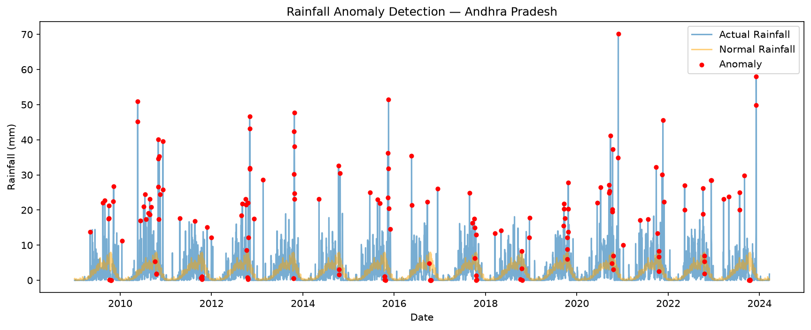

# Groundwater/Rainfall Anomaly Detection

A data science project that detects anomalous rainfall patterns across Indian states using unsupervised machine learning, flagging both unusually heavy rainfall (flood risk) and unusually low rainfall (drought risk) relative to historical norms.

## Dataset

- **Source:** Daily Rainfall Data - India (2009-2024), sourced from India Water Resources Information System (WRIS), via Kaggle
- **Size:** ~200,000 daily records across 28 states and 8 union territories
- **Columns used:** `date`, `state_name`, `actual` (rainfall in mm), `normal` (historical average rainfall)

## Method

1. **Data cleaning:** Removed records with missing `actual` or `normal` rainfall values; converted dates to proper datetime format.
2. **State-level filtering:** Focused analysis on a single state (Andhra Pradesh) for clear, interpretable results.
3. **Anomaly detection:** Used an Isolation Forest model (unsupervised learning) trained on `actual` and `normal` rainfall together, so anomalies are judged *relative to what's expected for that time of year* — not just in absolute terms. This catches both extreme rainfall spikes and abnormal dry spells.
4. **Evaluation:** Visualized flagged anomalies against the full rainfall time series to confirm they align with genuine extreme events (monsoon peaks, dry spells).

## Results

The model flagged ~3% of days as anomalous, correctly identifying the highest rainfall spikes in each monsoon season (including a ~70mm single-day event) as well as abnormally dry days.

## How to run this project

1. Clone this repository
2. Create and activate a virtual environment:

## Tools used

Python, pandas, NumPy, scikit-learn (Isolation Forest), Matplotlib

## Future improvements

- Extend analysis to all 28 states/UTs with a comparative dashboard
- Incorporate actual groundwater level data (not just rainfall) for a more complete hydrological picture
- Compare multiple anomaly detection methods (Z-score, DBSCAN, LSTM autoencoders) side by side